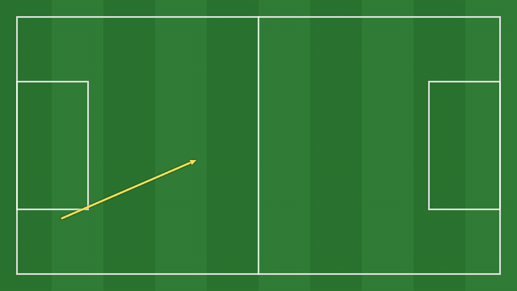

# MyFootballLens — lightweight football video analysis

Local, single-analyst tagging tool for football coaches and analysts: tag a match, cut highlights, draw on frames, read the stats.
A small Python server (FastAPI, in `.venv`) plus a plain HTML/JS UI in your browser.
The browser decodes the video on the GPU, and ffmpeg handles cutting and encoding in a separate low-priority process.
The server idles at about 50 MB of RAM.

## Start

1. **Get the code**, either way:
   - with git: `git clone https://github.com/as13af/MyFootballLens.git`
   - or on GitHub: **Code → Download ZIP**, then unzip it.
2. Install **Python 3.11+** and **ffmpeg**. ffmpeg is needed for exports and proxies; on Windows you can install it with `winget install Gyan.FFmpeg`.
3. Open the folder and double-click **`start.bat`**. The first run creates `.venv` and installs the two dependencies.

You can also start it by hand:

```
python -m venv .venv
.venv\Scripts\pip install -r requirements.txt
.venv\Scripts\python run.py            # opens http://127.0.0.1:8000
```

Options: `--port 8010`, `--no-browser`. `ffmpeg` and `ffprobe` must be on PATH.
To update a git copy later, run `git pull` in the folder (your `data/` folder is never touched).

## Workflow

1. **+ New match**: title, teams and colours, link the video (**Browse…**), and paste rosters one per line (`9 Jordan Smith ST`).
2. Set the **2nd-half kick-off** (video time) so the match clock and the 1st/2nd-half stats are correct.
3. **Tag**: press a code button's letter for Team A, or Shift+letter for Team B.
   - Each press creates a clip using that button's lead/lag, e.g. Shot = −8 s/+4 s.
   - **Toggle** buttons (⟲, e.g. Possession) run until you press them again. Starting the other team's toggle ends the current one.
4. The new tag is selected in the inspector. From there you can:
   - click the pitch for its location (Shift+click, or a second click on Cross/Corner/Free kick, sets the end point);
   - pick a player;
   - press **0–9** for descriptors (Success/Fail, On target, Left/Right/Head…);
   - add a note.
5. **Timeline**:
   - drag clip edges to trim, or drag a clip to move it;
   - double-click a clip to play it;
   - Ctrl+wheel zooms, Shift+wheel pans;
   - click a row label to filter to that row.
6. **Draw** (<kbd>`</kbd>): arrows, runs, lines, rings, player spotlight, zones, freehand and text.
   Saved drawings freeze playback for *Hold* seconds and are burned into exports as freeze-frames.
   - **Motion**: drawings animate on their own. See [Animated drawings](#animated-drawings) below.
   - **Curved arrow / curved run / curved line**: click the start, click a point the curve passes through, click the end.
     Esc or right-click cancels.
   - **Text**: click where it goes. A text box opens with:
     - text that wraps onto new lines by itself, so you can type a whole sentence in one go (Enter still starts a new line; Ctrl+Enter = done);
     - size;
     - width: how wide the text can get before it wraps, from 15% to 100% of the frame (default 40%). Lines never run past the right edge of the frame;
     - left/centre/right alignment;
     - bold/italic;
     - background (Dark / Light / Colour / None).

     Colour comes from the swatches. Double-click existing text to edit it.
   - **Select tool** (pointer icon):
     - click a shape to select it, then drag to move it;
     - drag its square handles to reshape it, or a curve's round yellow point to change the bend;
     - change its colour or width;
     - **Del** removes it, and **Ctrl+Z** undoes any change.
   - The **Drawings** tab lists every drawing with a preview, its time, and the clip(s) it will be exported with.
     From there you can **View**, **Edit**, change **Hold**, or **Delete** a drawing.
     Drawings that aren't inside any clip are flagged, and **+ Clip here** creates one around them.
   - Yellow triangles on the timeline ruler mark drawings: click one to jump exactly to it, double-click to edit it.
7. **Moments from your notes**: paste notes that end in video timestamps, and every line becomes a clip you can step through and draw on.
   See [Moments from your notes](#moments-from-your-notes) below.
8. **Playlists**: collect clips (the selected tag, ticked tags, or everything matching the filters), reorder them by drag, then **Play all** or **Export MP4**.
   Exports are frame-accurate. In the export dialog you can switch on or off:
   - **Captions**: time · event · team · player · labels;
   - **Notes**: each clip's note under the caption, wrapped to at most 2 lines (cut with "…") so it stays inside the frame;
   - **Drawings** and the **logo**.

   Encoding uses NVENC if available, then Intel QuickSync, then libx264.
   - **What's highlighted**: the selected clip has a solid bar on the left of its row and a glowing outline on the timeline.
     Clips under the playhead show a ▶ in the lists and a sand line on the timeline.
     The code-window button that made the selected clip stays outlined.
9. **Stats**:
   - goals, shots, on target, xG-lite and possession;
   - momentum per 5 minutes;
   - shot map;
   - heatmap / 18 zones / thirds;
   - event matrix with success %;
   - phase time and per-player counts.

   Click a number in the matrix to see those clips.
10. **Report** gives a printable HTML match report (use Print → Save as PDF).
11. **Live** tab: tag against a match clock during the game. Afterwards, enter both kick-off times in the video and **Sync**.
12. **Templates**: edit buttons (name, instant/toggle, lead/lag, hotkey, colour, A+B/neutral, location, end point) and descriptors (group, label, key, success/fail).
13. **Data ▾**: Sportscode-compatible XML import/export (`ALL_INSTANCES`), CSV export, exports folder.

## Moments from your notes

Use this when you watch a match and write notes like these:

```
Luke Vickery Moments
1st Half
0 – 5
LV pressed very well (17:38)
LV made a good run into space (19:22)
LV helping defense (1:00:21)
```

1. Go to **Data ▾ → Paste timestamps…**, or the **Moments** tab → **+ Paste timestamps…**, and paste your notes.
2. Check the preview:
   - every line with a time becomes a moment;
   - lines without a time (titles, "1st Half", "0 – 5") are skipped;
   - the first of those lines becomes the playlist name;
   - a time earlier than the line before it is highlighted, as it's often a typo.
3. Choose the **Event** (default *Key moment*), optionally a **Player** and **Team**, and how many seconds each clip starts before and ends after the timestamp (default 5 and 5).
4. Press **Add clips**. Each line becomes a clip with your text as its note, and they're all collected in a playlist.

Then open the **Moments** tab to work through them:

- Click a moment to jump there. The video stops exactly on your timestamp, not at the clip start.
- Press <kbd>N</kbd> / <kbd>Shift+N</kbd> for the next / previous moment.
  If your template gives N to a code button, use the list instead.
- Press <kbd>`</kbd>, **✎ Draw**, or double-click a row to draw on that frame. Rows with a drawing show ✎, and the header counts how many are done.
- **Export MP4** exports every moment as one video, with your drawings as freeze-frames.
  Your notes appear under the caption; untick **Notes** in the export dialog to leave them out.

Timestamps are read as **video time** (how far into the file), written as `m:ss`, `mm:ss` or `h:mm:ss`, anywhere on the line.
If you paste the same notes again, moments that already exist are skipped.

## Animated drawings



When a drawing appears, its shapes draw themselves in, in the order you drew them.
Each shape then loops a subtle effect for as long as the freeze-frame lasts.
This happens both in the app and in exported MP4s.

**Draw an animated frame**

1. Pause on the moment you want, then press <kbd>`</kbd> (or **✎ Draw**).
2. Draw your shapes in the order you want them to appear, e.g. the run first, then the pass, then the ring around the receiver.
3. Press **▶ Preview** to watch it play from the start.
4. Set **Hold** (how many seconds the frame freezes), then **Save drawing**.
   The button shows *Rendering animation…* for a few seconds while it prepares the frames for exports.

**Change how a shape moves**

1. Pick the **Select tool** (pointer icon) and click the shape.
2. Use the **Draw-on** button and the loop menu next to the colours:
   - **Draw-on** on/off: whether the shape draws itself in, or is there from the first frame.
   - **Loop**: what it does after drawing on. *(auto)* marks the default for that shape.
3. The shape replays straight away so you can see the change. Save the drawing to keep it.

| Shape | Draw-on | Default loop | Other loops |
|---|---|---|---|
| Arrow, curved arrow, line, freehand | grows from start to tip | **Pulse**: a soft breathing glow | None |
| Run (dashed), zone | grows / opens out | **Flow**: dashes march toward the tip or round the zone | Pulse, None |
| Ring, player spotlight | sweeps round / rises from the ground | **Ripple**: rings spreading outward | Pulse, None |
| Text | fades in | none | — |

**Tips**

- Keep **Hold** longer than the draw-on. With many shapes the draw-on takes about 2 seconds, so the default 3 s hold works well.
- Turn **Draw-on** off for context shapes (like a defensive line) so they're there straight away, and the key action draws in after them.
- Drawings saved before this feature animate in the app, but export as a still image until you open them and **Save drawing** again.
- Each animated drawing keeps its export frames in `data/drawings/<id>_anim/` (a few MB). They're deleted with the drawing.

## Branding

- **Colours** come from the MyFootballLens palette: #334162, #394D75, #809AD0, #C4AF9A, #660306 and white.
  There are two themes, switched with the sun/moon button in the top bar:
  - **Dark**: flat #334162 everywhere, separated by thin borders, with #809AD0 for active tabs and buttons.
  - **Light**: #809AD0 page, white panels, deep navy #1F2840 text, #334162 buttons with white text.

  Both use #C4AF9A for highlights and #660306 maroon for delete.
  The app follows your Windows light/dark setting until you press the button, then remembers your choice.
  Pitches stay navy in both themes; in dark they are one shade deeper (#2A3654) so they stand out from the flat background.
  The video area stays black in both themes.
- **Fonts** (all bundled, all SIL Open Font License; licence texts are in `static/fonts/OFL-*.txt`):
  - **Inter**: interface text, the match report, and the captions on exported videos (`app/assets/fonts/Inter-600.ttf`).
  - **Hubot Sans**: the app name, the intro and big headings.
  - **JetBrains Mono**: timecodes, the match clock and the timeline ruler, so digits stay put while the video plays.
- **Logo**: the MyFootballLens logo appears in the top bar and on the splash screen (`static/brand/`).
  The browser-tab icon is the transparent wordmark (`static/brand/favicon-64.png`).
- **Exports**: exported videos get the transparent logo bottom-right, at about 12% of the height and 85% opacity.
  Untick **Add MyFootballLens logo** in the export dialog to leave it out.
- The repository holds only the small logo copies the app needs.
  The full-size originals are kept privately in a local `logo/` folder, which is not uploaded.
  If you change the logo, regenerate the copies from those originals (with the app stopped):
  ```
  ffmpeg -y -i logo\2131.png -vf "format=rgba,colorkey=0xFFFFFF:0.06:0.12,scale=600:600:flags=lanczos" app\assets\watermark.png
  ffmpeg -y -i logo\2131.png -vf "scale=256:256:flags=lanczos" static\brand\logo-256.png
  ffmpeg -y -i "logo\2nd Logo_transparentadsa.png" -vf "format=rgba,scale=64:64:flags=lanczos" static\brand\favicon-64.png
  ```

## Keyboard

| Key | Action |
|---|---|
| Space | Play / pause (Live tab: start / pause clock) |
| ← / → | −5 s / +5 s (Shift: 1 s) |
| , / . | Frame back / forward |
| [ / ] | Slower / faster (0.25×–4×) |
| letter / Shift+letter | Tag for Team A / Team B |
| 0–9 | Descriptor on the selected tag |
| Enter | Play selected clip |
| PgUp / PgDn | Previous / next tag (respects filters) |
| Del | Delete selected tag (with Undo) |
| ` | Draw on frame (Esc closes, Ctrl+Z undoes) |
| Esc | Stop playlist / deselect |

## Keeping it light

- **Long, 4K or odd-codec files**: Match settings → **Create 720p proxy**. Playback then uses the proxy, which has a keyframe every second for instant seeking, while exports still use the original file.
- To use a separate data folder (for testing, or a second workspace), set `VAT_DATA_DIR` before starting, e.g. `set VAT_DATA_DIR=D:\analysis-2027` then run `start.bat`.
- Videos are linked by path, never copied. If you move a file, re-link it in Match settings.
- Everything lives in `data/`:
  - `analysis.db` (SQLite);
  - `backups/` (the last 10 copies, taken automatically at every start);
  - `exports/`, `drawings/` and `proxies/`.

## Layout

```
run.py / start.bat      launcher (picks a free port, opens the browser)
app/main.py             JSON API, video streaming (HTTP Range), report route
app/db.py               SQLite schema, backups, helpers
app/export.py           ffmpeg jobs: highlight export, proxies, encoder detection
app/stats.py            matrix, possession, xG-lite, momentum, positions()
app/report.py           printable report (inline SVG)
app/sportscode_xml.py   XML import/export
app/plugins/            reserved for a future OpenCV/YOLO tracker (see docstring)
static/                 index.html, css, js modules (no build step)
```

## Future: computer vision

v1 is deliberately manual (no OpenCV/YOLO), because PyTorch+YOLO would add 2–3 GB of install and 1.5–4 GB of RAM.
The hooks for adding it later are already in place:

- the `tracks` and `calibration` tables;
- the plugin contract in `app/plugins/__init__.py`;
- `stats.positions(source="tracks")`.

A tracker would install from its own `requirements-ai.txt`, run offline as a separate process, and feed the existing heatmaps.

## License

MyFootballLens is **open source** under the [MIT License](LICENSE). Copyright © 2026 Ali Shidqie.
You're welcome to use it, study it, modify it and build your own analysis tools from it.
Please keep the copyright notice in copies of the code.

The **MyFootballLens name and logo** are not covered by the MIT License.
If you publish a modified version, give it its own name and logo.
See [TRADEMARKS.md](TRADEMARKS.md).

Bundled third-party components (the Inter, Hubot Sans and JetBrains Mono fonts) keep their own open licences.
See [THIRD_PARTY_NOTICES.md](THIRD_PARTY_NOTICES.md).

Other product names, such as Sportscode, belong to their respective owners.
They are mentioned only to describe file-format compatibility.
MyFootballLens is not affiliated with or endorsed by them.
